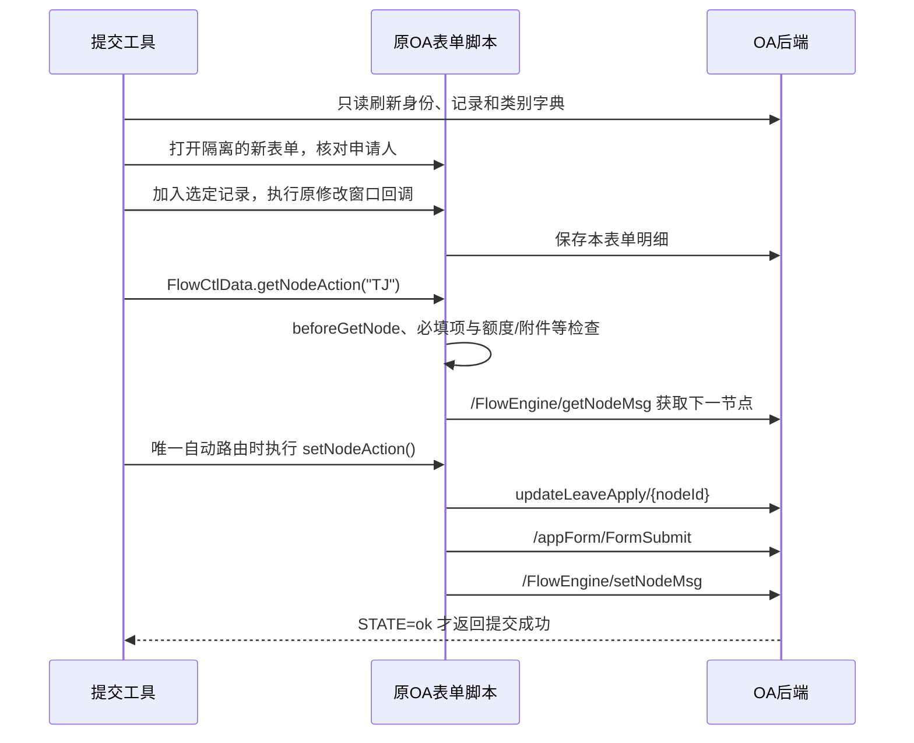

# 异常考勤页面调研与工具接入

调研日期：2026-11-08。通过用户已登录的外部 Chrome 查看真实页面，并读取页面保存的 HTML 及其引用的公开 JavaScript。随后使用项目 MySQL 会话完成真实只读接口联调，并按用户“仅核实流程，停在最终提交前”的指示，点击页面提交入口验证必填校验。未点击流程最终确认，未发送真实审批申请。业务接口与提交顺序依据下列原始脚本核实；最终审批写入尚未验证。

## 真实环境核验结果

- MySQL 已连接成功，当前账号存在已验证的持久化会话。
- 已通过实际注册的 `get_attendance_exceptions` 工具完成 `LangChain 工具 → LoginSession 工作线程 → MySQL → 真实 OA` 查询，返回本月一条异常和十六种抵消类别。
- 已核实 `/getPsn?extension`、异常查询、类别字典和表格列定义的真实响应。原身份接口返回 JSON，但响应头是 `text/html;charset=UTF-8`；已修复仅看响应头就误判登录失败的问题。现在先解析 JSON，解析失败后才识别真实登录 HTML。
- 实际列定义确认备注为 `bz`，故障卡机为 `gzkjwz`。代码仍按“备注”列动态读取字段编码，兼容后续列编码调整。
- 外部 Chrome 中，保持抵消类别为空，点击表单上方“提交”，原页面显示“请选择抵消类别！”，阻止继续操作。
- 只读复查该研究表单的流程历史，没有 `TJ` 提交记录。
- 本次没有为真实记录编造抵消理由、实际时间或备注，没有执行明细修改、请假表更新、表单保存和最终 `setNodeMsg`。选择类别后的下一审批人解析及最终写入仍未实测，不能据本次结果宣称完整生产提交成功。

## 页面与交互

入口：[异常考勤处理申请](https://soa.com.cn/appForm/OpenForm?fromid=abnormalattendapp)，`formid=abnormalattendapp`，`bpmid=I01030101A`。这是旧 OA 的 Vue 2 动态表单，不是 SIO 门户的普通 REST 创建接口。

1. 页面生成新的 `DOCID`，读取当前登录人的身份、部门、考勤卡号、工作地、公司及审批关系。申请人等字段只读；业务管理线可能是必填选项。
2. 年份支持上一年、当年、下一年；月份为 1–12。新建时默认当前年月，并自动查询异常记录。
3. 点击“获取异常记录”会清除该表单现有明细，再查询并写入新明细。**页面查询按钮会写临时明细；工具的查询改为直接调用只读接口。**
4. 选中记录后点击“修改”打开编辑窗口。页面提示可以双击行和批量修改；本次实际通过复选框加“修改”打开窗口。
5. 抵消类别打开单独的字典选择窗口。已观察到“卡机故障”“忘打卡”“公出”“调休”等；它们属于动态配置，不能在工具中写死整份枚举。卡机故障和忘打卡当前均可对应 `A013`，因此不能仅用类别编码区别业务。
6. 忘打卡、卡机故障联动显示实际开始/结束时间；卡机故障还显示故障位置。备注字段编码从表格列定义中读取。
7. “保存”是保存草稿，“提交”会先执行校验、计算汇总及申请编号，再获取下一审批节点、弹出流程确认窗口，最后确认推进审批。

## 数据获取

请求主机均为 `https://soa.com.cn`；后端沿用数据库 Cookie 的域名与路径约束。未登录时，该表单地址可能在原 URL 返回 **HTTP 200 的登录 HTML**；身份接口正常返回 JSON 时也可能声明 `text/html`。必须检查实际内容，不能仅凭 HTTP 状态或 Content-Type 判定认证。仅 SIO 身份接口成功也不代表旧 OA 表单认证成功。

| 用途 | 请求与关键参数 | 解析方式 |
| --- | --- | --- |
| 当前身份 | `POST /getPsn?extension`，表单参数 `type=getLoginPsn`、`getfield=USRID;NAME2;ZZGZD;BEGDA` | 返回人员数组；核对 `USRID` 与本机账号一致，取工作地 `ZZGZD`、入职日期 `BEGDA` |
| 异常记录 | `GET /gateway/attendance/abnormalattendapp/getAbnormalAttend` | 见下文 |
| 抵消类别 | `GET /appForm/GetViewData`，`viewName` 和 `viewTable` 均为 `v_attendandeductapp_config1`，`pageNum=1&pageSize=1000&getType=all&deltype=true` | `data.records` 中的 `type`、`typecode` |
| 表格定义和明细 | `/appForm/getTable` | 原组件负责读取；写操作包括 `addManyRow`、`changerow`、`delrow` |
| 年假配置 | `POST /gateway/form/commonInterface/getAnnualleave`，JSON 包含 `psnnum`、`curyear` | 原页面负责额度校验 |
| 申请单号 | `POST https://msp.soa.com.cn/api/sap/serialNumber/getNumber` | 原脚本使用 `token` 头；申请前缀、日期和流水号规则由原页面决定 |

异常记录查询参数如下，**`starTime` 就是原脚本拼写**：

```text
starTime=YYYY-MM-01
endTime=YYYY-MM-当月最后一天
workplaceid=当前登录人的ZZGZD
itcode=当前登录人的USRID
postflag=abnormalattendapp
```

入职当月的开始日期取不早于 `BEGDA` 的日期。响应要求 `code=200`，遍历 `data` 下的分组，仅显示 `workday` 为真且 `qjxs>0` 的记录；若存在 `data.lastNeedEndDate`，原页面会阻止继续处理并显示原因。

| 字段 | 含义 |
| --- | --- |
| `rq` | 异常日期 |
| `dk` / `dk2` | 原始开始、结束打卡时间 |
| `lx` | 异常类型 |
| `qjxs` / `qjt` | 需请假小时、天数，保持服务端原值 |
| `dxlb` / `dxlbbm` | 抵消类别名称、编码 |
| `ks` / `js` | 实际开始、结束时间 |
| `gzkjwz` | 故障卡机位置 |
| `rowid` | 新表单明细的内部行标识，由 OA 生成 |

工具返回独立的 `record_id`，对应十分钟有效的本地查询快照；不允许模型提供工号、工作地、原始时长、`DOCID`、审批人或认证数据。

## 提交链路及业务约束



原脚本校验至少包括：明细非空、每行选择抵消类别、名称和类别编码一致、年假额度、部分假别证明附件、直属领导、人员适用范围和业务管理线。病假超过两天或特定政策假需要证明；类别还会影响审批路线。汇总天数、审批人和编号由原页面维护。

因此提交工具执行原页面及公共组件的方法，不自行构造 `authCtrl`、`serializeData`、审批人或 `nextFlow`。它先替换**本次新表单**的默认明细，只加入用户选定的异常记录，再逐行调用原修改窗口、类别选择回调、确认方法和流程入口。不会修改已有工单。

## 已实现工具

- `get_attendance_exceptions(year, month)`：只读获取本人记录，返回 `draft_id`、`record_id`、异常字段与可选类别。
- `submit_abnormal_attendance(draft_id, items)`：刷新只读数据，核对记录未变化后，提交选定项。`items` 接受 `record_id`、`offset_type`、`remark`；忘打卡和卡机故障还需 `actual_start`、`actual_end`，卡机故障需 `device_location`。

已注册到 Streamlit 的 Agent。用户可以先说“查询 2026 年 11 月的异常考勤”，再明确选择异常和真实抵消方式后要求提交。不能自动将所有异常改为某种假别，也不能推测实际在司时间。

可信后端示例：

```python
result = session.call("attendance_query", {"year": 2026, "month": 11})
# 根据真实记录和用户指令填写，不要直接照抄示例业务内容。
submitted = session.call("attendance_submit", {
    "draft_id": result["draft_id"],
    "items": [{
        "record_id": result["records"][0]["record_id"],
        "offset_type": "用户选定的类别",
        "remark": "用户提供的真实说明",
    }],
})
```

只读身份/异常查询允许一次认证恢复；**提交不进入自动重放执行器**。一个快照最多尝试一次写入，重复调用返回缓存结果。`success` 只表示已提交审批；`unknown` 表示可能部分写入或已提交，应先打开返回的原工单链接核实，不能自动重试，也不能重新查询后自动重复提交。

## 当前边界与验证

- 本次用外部浏览器研究页面。项目运行仍使用已有 MySQL 会话和独立浏览器上下文，**不会读取或导入系统 Chrome 的个人资料、Cookie 文件**。已验证现有数据库 Cookie 组合可访问旧 OA 身份、表单和异常查询；没有单独验证仅 SIO Token 能否建立旧 OA 会话。
- 暂不上传附件。明确需要证明的申请在写入前返回 `manual_required`。多审批分支、需人工选审批人或原页面校验不通过时停止，由用户打开原表单办理。
- 临时快照与重复调用结果保存在当前 `LoginSession` 内存中，十分钟后过期；清除会话或应用重启后不保留。它不是服务端幂等键，也不提供跨进程、跨快照或多实例的防重保证。结果不明的申请必须先查 OA。
- 提交可能先写明细，再更新请假表，最后推进审批。任何阶段失败都可能留下未提交表单或部分写入，当前不擅自回滚、作废或删除。
- 原 OA 脚本和动态表格定义是运行依赖；改版可能导致工具停止并要求人工核实。没有将真实个人数据、Cookie 或响应原文作为测试样本提交进仓库。
- 79 项自动测试通过，覆盖身份校验、HTTP 200 登录页、JSON 错标 HTML、年月、入职日期、记录变化、字典变化、认证恢复、提交异常不重放、快照过期和工作线程传参。
- `tests/integration/attendance_smoke.py` 使用真实隔离 Chrome 运行项目提交桥接脚本，所有页面和网络响应均由模拟路由拦截。验证选定记录、动态备注字段、特殊字符、唯一流程分支、原页面校验阻断、最终 `STATE` 判定及重复调用。
- **真实查询和提交前的空类别阻断已验证；未提交真实 OA 工单，也未验证最终审批结果。** 模拟页面只验证桥接协议，不替代 OA 实际业务规则联调。

复现测试：

```bash
python -m unittest discover -s tests -v
python tests/integration/attendance_smoke.py
```

原始参考：[业务脚本](https://oastatic.sugon.com/OA/hr/abnormalattendapp.js?open&vs=14)、[流程引擎脚本](https://oastatic.sugon.com/OA/flowManage/flowControl.js?vs=17)、[表单组件](https://oastatic.sugon.com/OA/v8/appform/component.js?vs=21)、[公共业务函数](https://oastatic.sugon.com/OA/v8/bx_common.js?vs=9)。
